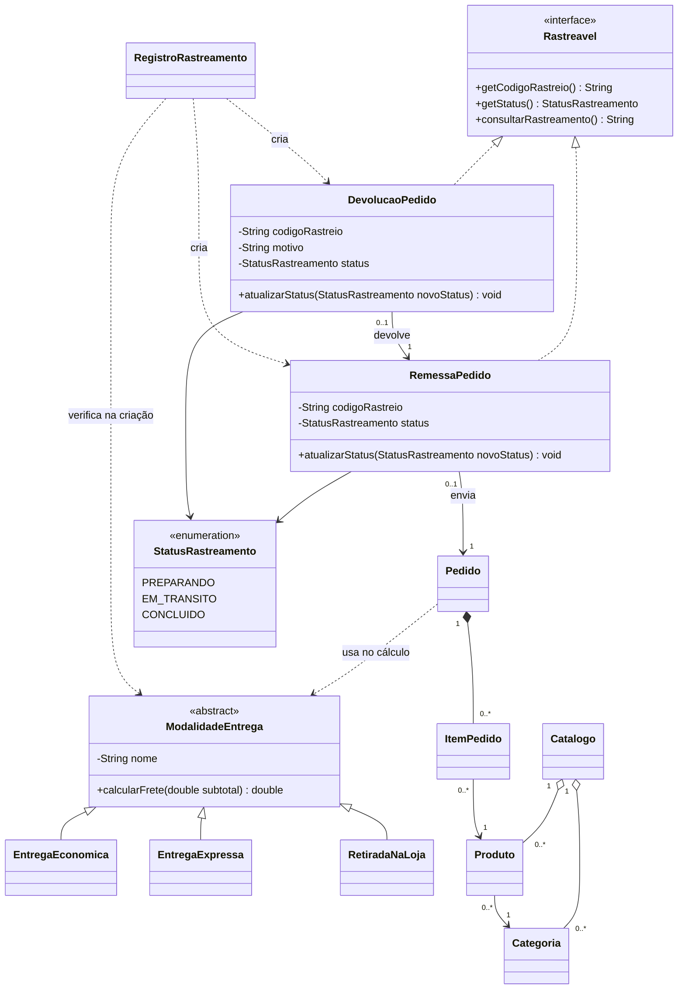

# Atividade Loja Virtual

Uma pequena loja precisa organizar seu catálogo e simular pedidos. O gerente pode cadastrar categorias e produtos. Cada pedido reúne produtos e quantidades, e o cliente pode comparar o valor final usando diferentes modalidades de entrega.

Implemente as partes indicadas no projeto-base. Os dados serão criados no `main`; cadastrar significa inserir objetos nas estruturas em memória. Não é necessário criar uma tela para o gerente. A atividade será realizada em etapas: primeiro o catálogo, os pedidos e as modalidades de entrega; depois, após a introdução a interfaces, o rastreamento de remessas e devoluções. A etapa de rastreamento usa o pedido já implementado e não exige promoções ou repositórios.

## Etapa 1 — arquivos e tarefas

Use o projeto-base específico distribuído pelo professor. A loja de referência e os exemplos da aula 07 são projetos independentes, com construtores e nomes de métodos diferentes; não copie seus arquivos para este projeto.

| Arquivo | Fornecido | Implementar |
|---|---|---|
| `Categoria.java`, `Produto.java` | Classes completas, construtores, getters e validações. | Nenhuma parte. |
| `Catalogo.java` | Listas inicializadas, construtor, cadastros e busca. | `listarPorCategoria`. |
| `ItemPedido.java` | Atributos, construtor, `getProduto()` e `getQuantidade()`. | `calcularSubtotal` e `aumentarQuantidade`. |
| `Pedido.java` | Lista inicializada e construtor sem argumentos. | Ambas as versões de `adicionarProduto`, `calcularSubtotal`, `calcularTotal` e `contarItens`. |
| `ModalidadeEntrega.java` | Nome, construtor protegido e `getNome()`. | Declarar a classe abstrata e a operação abstrata `calcularFrete`. |
| Três subclasses de entrega | Arquivos e construtores com nomes e chamada a `super`. | Declarar a herança e implementar `calcularFrete` com `@Override`. |
| `Main.java` | Dados, impressão, estrutura dos cenários e captura de erros. | Completar chamadas com `TODO` e registrar resultados. |

Os trechos de lançamento de exceções são fornecidos; nos métodos da dupla, vocês escrevem as condições de validação antes de modificar objetos. Implemente nesta ordem: subtotal do item, aumento de quantidade, adição ao pedido, subtotal e contagem, modalidades e total, filtro e cenários.

## Classes e responsabilidades

| Classe | Dados principais | Responsabilidade |
|---|---|---|
| `Categoria` | `codigo`, `nome` | Representar uma categoria cadastrável. |
| `Produto` | `codigo`, `nome`, `preco`, `categoria` | Representar um produto do catálogo. |
| `Catalogo` | Categorias e produtos | Cadastrar, buscar por código e listar produtos de uma categoria. |
| `ItemPedido` | `produto`, `quantidade` | Representar uma linha do pedido e calcular seu subtotal. |
| `Pedido` | Lista de itens | Adicionar produtos, calcular subtotal e calcular total com entrega. |
| `ModalidadeEntrega` | `nome` | Definir a operação abstrata de cálculo de frete. |
| `EntregaEconomica` | Dados herdados | Aplicar tarifa fixa ou gratuidade conforme o subtotal. |
| `EntregaExpressa` | Dados herdados | Aplicar tarifa fixa de entrega expressa. |
| `RetiradaNaLoja` | Dados herdados | Aplicar frete zero. |
| `Rastreavel` — etapa de rastreamento | Contrato de consulta | Consultar código, status e descrição do rastreamento. |
| `StatusRastreamento` — etapa de rastreamento | `PREPARANDO`, `EM_TRANSITO`, `CONCLUIDO` | Definir os estados permitidos do transporte. |
| `RemessaPedido` — etapa de rastreamento | Pedido, código de rastreio, status | Representar o envio da loja ao cliente. |
| `DevolucaoPedido` — etapa de rastreamento | Remessa original, código de rastreio, motivo, status | Representar o retorno integral do cliente à loja. |
| `RegistroRastreamento` — fornecido na etapa 2 | Transportes registrados nesta execução | Criar transportes, controlar unicidade e impedir envio para retirada na loja. |

## Relações do modelo



O pedido cria seus próprios itens; não recebe um `ItemPedido` pronto. Um produto existe independentemente do pedido e pode ser compartilhado por vários pedidos. A composição representa a propriedade dos itens pelo pedido, não uma instrução de destruição imediata de objetos em Java.

O diagrama inclui a etapa de rastreamento. Cada pedido tem no máximo uma remessa e cada remessa no máximo uma devolução integral. Remessa e devolução implementam `Rastreavel`; não herdam de `Pedido` ou de `ModalidadeEntrega`. A modalidade calcula frete, enquanto a remessa representa um envio. O controle de unicidade é fornecido em RegistroRastreamento; o Main chama suas operações de criação.

## Regras de negócio

| Regra | Descrição | Método e tarefa |
|---|---|---|
| RN01 | Códigos são inteiros positivos. Nomes não podem ser nulos, vazios ou apenas espaços. | Construtores de Categoria e Produto — fornecidos |
| RN02 | O preço deve ser positivo e finito. Todo produto possui uma categoria não nula. | Construtor de Produto — fornecido |
| RN03 | O catálogo não aceita código de categoria repetido nem código de produto repetido. Um código de categoria pode coincidir com um código de produto. | Catalogo.cadastrarCategoria e cadastrarProduto — fornecidos |
| RN04 | Um produto só pode ser cadastrado se sua categoria já estiver cadastrada, usando o objeto de categoria registrado no catálogo. | Catalogo.cadastrarProduto — fornecido |
| RN05 | O filtro rejeita categoria nula, compara códigos e devolve uma nova lista; sem correspondências, devolve lista vazia. Alterar o resultado não altera o catálogo. | Catalogo.listarPorCategoria — implementar |
| RN06 | Adicionar um produto exige referência não nula e quantidade maior que zero. A versão sem quantidade adiciona uma unidade. | Pedido.adicionarProduto(produto, quantidade); versão sem quantidade delega com 1 — implementar |
| RN07 | Adicionar novamente o mesmo código de produto aumenta a quantidade da linha existente. Não cria outra linha. | Pedido.adicionarProduto localiza a linha pelo código; ItemPedido.aumentarQuantidade soma o incremento — implementar |
| RN08 | O subtotal do item é preço × quantidade. O subtotal do pedido é a soma dos subtotais dos itens. Pedido vazio tem subtotal zero. | ItemPedido.calcularSubtotal multiplica; Pedido.calcularSubtotal acumula — implementar |
| RN09 | Entrega econômica custa R$ 10,00 para subtotal menor que R$ 200,00 e é gratuita a partir de R$ 200,00, inclusive. | EntregaEconomica.calcularFrete — implementar |
| RN10 | Entrega expressa custa R$ 20,00, independentemente do subtotal. Retirada na loja é gratuita. | EntregaExpressa.calcularFrete e RetiradaNaLoja.calcularFrete — implementar |
| RN11 | O total é subtotal + frete. Calcular total exige pedido com pelo menos um item e modalidade não nula. | Pedido.calcularTotal — implementar |
| RN12 | Calcular o total não modifica os itens nem armazena a modalidade. O mesmo pedido pode ser simulado com todas as modalidades. | Pedido.calcularTotal — implementar |
| RN13 | Contar linhas, não unidades. Pedido vazio tem zero linhas. | Pedido.contarItens — implementar |
| RN14 | Aumentar quantidade exige incremento positivo; somar, sem substituir a quantidade atual. Tentativa inválida preserva o item. | ItemPedido.aumentarQuantidade — implementar |

Para simplificar, os produtos permanecem com preço e categoria fixos após a criação e possuem códigos únicos no catálogo. O `main` usa nos pedidos os objetos obtidos desse catálogo. Não há controle de estoque, descontos, impostos, pagamento ou fechamento no núcleo.

Use `double` para acompanhar o exemplo já estudado e apresente valores monetários com duas casas decimais. Nos testes, compare valores com tolerância, por exemplo `0.001`. Essa é uma simplificação didática; a representação monetária pode ser revista em uma etapa posterior.

As operações inválidas devem lançar `IllegalArgumentException`; calcular o total de um pedido vazio deve lançar `IllegalStateException`. O professor fornece os trechos de lançamento e captura para que o foco seja identificar e implementar as condições. Valide antes de modificar a quantidade ou inserir um item: uma tentativa inválida deve preservar o pedido.

As regras RT01 a RT11 da etapa de rastreamento complementam as regras acima. Consultar rastreamento não altera o cálculo do pedido.

## Contratos mínimos a implementar

```java
// Catalogo
public ArrayList<Produto> listarPorCategoria(Categoria categoria);

// ItemPedido
public double calcularSubtotal();
public void aumentarQuantidade(int quantidade);

// Pedido
public void adicionarProduto(Produto produto);
public void adicionarProduto(Produto produto, int quantidade);
public double calcularSubtotal();
public double calcularTotal(ModalidadeEntrega modalidade);
public int contarItens(); // número de linhas, não de unidades

// ModalidadeEntrega
public abstract double calcularFrete(double subtotal);
```

O filtro rejeita categoria nula. A classe abstrata fornece construtor para o nome e `getNome()`. Cada subclasse define seu nome via `super` e implementa `calcularFrete` com `@Override`. O parâmetro do frete será o subtotal não negativo calculado pelo pedido.

Exemplos de chamadas válidas a operações fornecidas, dentro do `main`:

```java
Categoria perifericos = new Categoria(1, "Periféricos");
Produto mouse = new Produto(102, "Mouse", 50.0, perifericos);
Catalogo catalogo = new Catalogo();
catalogo.cadastrarCategoria(perifericos);
catalogo.cadastrarProduto(mouse);
Produto encontrado = catalogo.buscarProduto(102); // null se não encontrado
Pedido pedido = new Pedido();
ModalidadeEntrega economica = new EntregaEconomica();
```

`ItemPedido` recebe produto e quantidade no construtor, utilizado por `Pedido`. O projeto-base fornece seus getters. Um item nunca possui quantidade zero ou negativa.

## Exigências de POO

1. `ModalidadeEntrega` deve ser abstrata. Ela não possui um cálculo genérico de frete para ser instanciada diretamente.
2. As três modalidades devem herdar dessa classe e sobrescrever `calcularFrete`.
3. `Pedido.calcularTotal` deve chamar `modalidade.calcularFrete(subtotal)`. Não selecionar a regra de entrega por nome, `instanceof`, `switch` ou conversão de tipos.
4. `adicionarProduto(produto)` deve delegar para `adicionarProduto(produto, 1)`, concentrando a regra na versão com quantidade.
5. Os atributos devem ser privados. A quantidade deve mudar por uma operação que preserve sua validade.
6. Na etapa de rastreamento, `RemessaPedido` e `DevolucaoPedido` devem implementar `Rastreavel`. O laço de consulta deve usar a interface, sem `instanceof`, conversão de tipos ou seleção pelo nome da classe.

A sobrecarga ocorre entre as duas assinaturas de `adicionarProduto`, escolhidas conforme os argumentos da chamada. A sobrescrita ocorre nas subclasses de entrega; a implementação executada depende do objeto recebido como `ModalidadeEntrega`.

### Exemplo de uso esperado

```java
Categoria perifericos = new Categoria(1, "Periféricos");
Categoria papelaria = new Categoria(2, "Papelaria");
Catalogo catalogo = new Catalogo();
catalogo.cadastrarCategoria(perifericos);
catalogo.cadastrarCategoria(papelaria);

Produto teclado = new Produto(101, "Teclado", 120.0, perifericos);
Produto mouse = new Produto(102, "Mouse", 50.0, perifericos);
Produto caderno = new Produto(103, "Caderno", 30.0, papelaria);
catalogo.cadastrarProduto(teclado);
catalogo.cadastrarProduto(mouse);
catalogo.cadastrarProduto(caderno);

Pedido pedido = new Pedido();
pedido.adicionarProduto(teclado);
pedido.adicionarProduto(mouse);
pedido.adicionarProduto(mouse); // aumenta a quantidade da linha do mouse

ModalidadeEntrega[] modalidades = {
    new EntregaEconomica(),
    new EntregaExpressa(),
    new RetiradaNaLoja()
};

System.out.println("Linhas: " + pedido.contarItens()); // 2
System.out.printf("Subtotal: R$ %.2f%n", pedido.calcularSubtotal()); // 220,00
for (ModalidadeEntrega modalidade : modalidades) {
    System.out.printf("%s: R$ %.2f%n",
        modalidade.getNome(), pedido.calcularTotal(modalidade));
}
```

Resultados: econômica R$ 220,00; expressa R$ 240,00; retirada R$ 220,00. O separador decimal da impressão depende da configuração de localidade do ambiente.

### Cenários de verificação obrigatórios

Cada cenário de pedido começa com um novo pedido, salvo indicação contrária.

| Cenário | Resultado esperado |
|---|---|
| Teclado de R$ 120,00 + duas unidades de mouse de R$ 50,00 | Duas linhas; subtotal R$ 220,00; totais R$ 220,00 / R$ 240,00 / R$ 220,00, na ordem econômica / expressa / retirada. |
| Uma unidade de mouse | Subtotal R$ 50,00; econômica total R$ 60,00. |
| Quatro unidades de mouse | Subtotal R$ 200,00; econômica total R$ 200,00. |
| Subtotal de R$ 199,99, com produto específico para teste | Frete econômico R$ 10,00; total R$ 209,99. |
| Adicionar mouse sem quantidade e depois com quantidade 2 | Uma linha com três unidades; subtotal R$ 150,00. |
| Adicionar quantidade zero ou negativa a um pedido com mouse | IllegalArgumentException; quantidade e subtotal anteriores preservados. |
| Adicionar produto nulo | IllegalArgumentException; pedido preservado. |
| Pedido vazio | Subtotal zero; calcularTotal lança IllegalStateException. |
| Pedido não vazio com modalidade nula | calcularTotal lança IllegalArgumentException. |
| Filtrar Periféricos no catálogo do exemplo | Teclado e mouse; caderno não aparece. |
| Cadastrar categoria “Livros”, sem produtos, e filtrá-la | Lista vazia; nenhuma alteração no código da classe `Categoria`. |

Acrescente cenários para filtro com categoria nula e aumentarQuantidade com incremento zero ou negativo: IllegalArgumentException e estado anterior preservado. RN01 a RN04 são verificações do código fornecido, não implementações da dupla. Registre resultado esperado e obtido. Não é obrigatório usar JUnit; verificações no `main` são suficientes. O professor fornece a estrutura para executar todos os cenários sem interromper a aplicação no primeiro erro esperado.

### Entrega da etapa 1

- Arquivos `.java` que compilam e executam.
- `Main` demonstrando sobrecarga, repetição de produto e execução polimórfica das três modalidades.
- Registro dos cenários de verificação em um pequeno `README.md`.
- Respostas breves: por que categoria é classe? Onde há composição? Qual a diferença entre sobrecarga e sobrescrita neste programa? O que precisa mudar para acrescentar uma modalidade de entrega?


Avaliação da etapa 1: item e pedido (3 pontos), herança e chamada polimórfica (3), sobrecarga e filtro (1,5), validações implementadas e cenários (1,5), explicação das relações (1). Não pontuar partes fornecidas.

## Etapa 2 — interfaces: rastreamento de remessas e devoluções

### Arquivos e tarefas

| Arquivo | Fornecido | Implementar |
|---|---|---|
| `StatusRastreamento.java` | Enum completo. | Nenhuma parte. |
| `RemessaPedido.java`, `DevolucaoPedido.java` | Atributos, construtores, getters das associações e motivo, validações e atualização de status. | Declarar `implements Rastreavel` e implementar os três métodos públicos da interface com `@Override`. |
| `Rastreavel.java` | Arquivo indicado para criação. | Interface e três métodos especificados abaixo. |
| `RegistroRastreamento.java` | Classe completa com criação e controle dos transportes. | Nenhuma parte. |
| `Main.java` | Um registro, dados e cenários de erros. | Array e laço de consulta; registro dos resultados. |

Implemente primeiro a interface, depois os getters e as descrições, e por fim o laço. Construtores, transições e unicidade não são implementados pelos alunos nesta etapa.

### Contexto e objetivo

Depois de montar um pedido, a loja envia seus produtos ao cliente. Se o cliente devolver a compra, um novo transporte leva os produtos de volta à loja. Os dois transportes têm código e status consultáveis, mas a conclusão de cada um possui um significado diferente: entrega ao cliente ou recebimento pela loja.

Implemente `Rastreavel` em `RemessaPedido` e `DevolucaoPedido`. O objetivo é usar um mesmo contrato para consultar objetos de classes diferentes. O pedido é a compra; a remessa é seu envio; a devolução é o retorno. Nenhum dos dois transportes é uma subclasse de `Pedido` ou de `ModalidadeEntrega`.

O rastreamento é uma simulação em memória, atualizada no `Main`, sem API de transportadora, localização em mapa, histórico de eventos ou datas. A devolução é integral; devolução parcial, reembolso, estoque e custos do retorno ficam para outra atividade.

### Contratos e responsabilidades

```java
public interface Rastreavel {
    String getCodigoRastreio();
    StatusRastreamento getStatus();
    String consultarRastreamento();
}

public enum StatusRastreamento {
    PREPARANDO, EM_TRANSITO, CONCLUIDO
}
```

`consultarRastreamento()` devolve uma descrição e não imprime nem altera estado. Na remessa, os textos são "Remessa em preparação", "Remessa em trânsito" e "Remessa entregue ao cliente". Na devolução, são "Devolução em preparação", "Devolução em trânsito" e "Devolução recebida pela loja". O código e o status são obtidos pelos outros métodos do contrato.

A interface declara apenas consultas. `atualizarStatus` pertence às classes concretas: nesta atividade, quem acompanha o transporte não precisa também ter a capacidade de alterá-lo. Não é necessário criar uma superclasse comum para compartilhar atributos; a pequena repetição permite concentrar a discussão no contrato da interface.

Contratos das operações fornecidas (notação de assinatura; os corpos já estão no projeto-base, não copiar estas linhas como implementação):

```java
// RemessaPedido implements Rastreavel
public RemessaPedido(String codigoRastreio, Pedido pedido);
public Pedido getPedido();
public void atualizarStatus(StatusRastreamento novoStatus);

// DevolucaoPedido implements Rastreavel
public DevolucaoPedido(String codigoRastreio,
                       RemessaPedido remessaOriginal, String motivo);
public RemessaPedido getRemessaOriginal();
public String getMotivo();
public void atualizarStatus(StatusRastreamento novoStatus);
```

Os atributos são privados. Código, pedido, remessa original e motivo não mudam depois da construção; somente o status é atualizado. A devolução identifica o pedido por `remessaOriginal.getPedido()`, sem armazenar uma segunda referência independente. O enum é adequado porque os estados são um conjunto fechado definido pelas regras.

### Regras de negócio do rastreamento

| Regra | Descrição | Responsável |
|---|---|---|
| RT01 | Remover espaços nas extremidades com trim() antes de armazenar o código; rejeitar nulo ou resultado vazio. Unicidade compara o texto normalizado, distinguindo maiúsculas e minúsculas. | Construtores dos transportes — fornecidos |
| RT02 | Códigos de rastreio são únicos entre remessas e devoluções. Cada pedido tem no máximo uma remessa e cada remessa no máximo uma devolução integral. | RegistroRastreamento.criarRemessa e criarDevolucao — fornecidos |
| RT03 | Criar remessa exige pedido não nulo e com pelo menos um item. | Construtor de RemessaPedido — fornecido |
| RT04 | Ambos os transportes começam em `PREPARANDO`. Só são aceitas as transições `PREPARANDO → EM_TRANSITO → CONCLUIDO`. Repetir o estado atual, pular uma etapa ou retroceder é rejeitado. | Construtores e atualizarStatus das duas classes — fornecidos |
| RT05 | Atualização com status nulo é rejeitada. Toda tentativa inválida preserva o status anterior. | atualizarStatus das duas classes — fornecido |
| RT06 | Criar devolução exige remessa original não nula e em `CONCLUIDO`, além de motivo não nulo e não vazio após `trim()`. O motivo é armazenado sem espaços nas extremidades. | Construtor de DevolucaoPedido — fornecido |
| RT07 | Concluir a remessa significa entregar ao cliente; concluir a devolução significa receber o retorno na loja. A devolução não muda o status da remessa original. | consultarRastreamento — implementar; atualizarStatus — fornecido |
| RT08 | Consultas de rastreamento não modificam status, quantidades, preços ou totais. | Três consultas de Rastreavel — implementar |
| RT09 | Retirada na loja não gera remessa ou devolução rastreável nesta simulação. Calcular um total, por si só, não cria transporte. | RegistroRastreamento.criarRemessa — fornecido |
| RT10 | Depois de criada a remessa, o exemplo não altera os itens ou preços do pedido. A devolução abrange todos os itens desse pedido. Bloqueio automático de alterações e cópia do conteúdo enviado ficam para uma evolução. | Fluxo fornecido no `Main` |
| RT11 | getCodigoRastreio retorna o código armazenado normalizado; getStatus retorna o enum atual, não uma descrição. | getCodigoRastreio e getStatus das duas classes — implementar |

Use `IllegalArgumentException` para parâmetros inválidos e `IllegalStateException` para pedido vazio, remessa ainda não entregue ou transição proibida. Os construtores e as transições já incluem os lançamentos; o Main fornece as capturas dos erros esperados. O registro verifica unicidade; os construtores verificam somente os dados recebidos. Não implementar essas verificações nesta etapa.

### Criação pelo registro fornecido

Use uma única instância de RegistroRastreamento nos cenários que verificam unicidade. Suas operações fornecidas são descritas abaixo; o aluno apenas as chama.

| Método | Parâmetros | Retorno |
|---|---|---|
| criarRemessa | String codigoRastreio, Pedido pedido, ModalidadeEntrega modalidade | RemessaPedido |
| criarDevolucao | String codigoRastreio, RemessaPedido remessaOriginal, String motivo | DevolucaoPedido |

criarRemessa rejeita modalidade nula com IllegalArgumentException e retirada na loja com IllegalStateException. A modalidade é usada apenas nessa escolha; o pedido não a armazena. criarDevolucao exige uma remessa registrada na mesma instância do registro. Unicidade de pedido e remessa usa a mesma referência de objeto, pois esta atividade não usa códigos nem cópias de pedidos.

Código repetido e segunda remessa/devolução lançam IllegalStateException. Remessa externa ao registro lança IllegalArgumentException. Todas as validações precedem o registro; uma falha não ocupa o código nem cria associação. Nos exemplos e cenários, crie transportes por essas operações. Os construtores são utilizados internamente pelo registro, sem controle global de unicidade.

O registro fornecido pode verificar o tipo da modalidade para rejeitar retirada. A proibição de selecionar classes aplica-se ao cálculo polimórfico do frete e ao laço de consulta que vocês implementam.

### Demonstração de polimorfismo pela interface

Após criar um `pedido` válido:

```java
RegistroRastreamento registro = new RegistroRastreamento();
RemessaPedido remessa = registro.criarRemessa(
    "ENV-001", pedido, new EntregaEconomica());
remessa.atualizarStatus(StatusRastreamento.EM_TRANSITO);
remessa.atualizarStatus(StatusRastreamento.CONCLUIDO);

DevolucaoPedido devolucao =
    registro.criarDevolucao("DEV-001", remessa, "Produto diferente do solicitado");
devolucao.atualizarStatus(StatusRastreamento.EM_TRANSITO);

Rastreavel[] transportes = { remessa, devolucao };
for (Rastreavel transporte : transportes) {
    System.out.println(transporte.getCodigoRastreio() + ": "
        + transporte.consultarRastreamento());
}
```

Saída esperada:

```text
ENV-001: Remessa entregue ao cliente
DEV-001: Devolução em trânsito
```

O laço usa apenas métodos de `Rastreavel`. Não usar `instanceof`, conversão de tipos ou seleção pelo nome da classe para produzir a descrição. Cada implementação pode usar condições sobre seu próprio status; isso não substitui a chamada polimórfica pela interface.

### Cenários desta etapa

**Sua implementação:** conferir os códigos e enums retornados, as seis descrições (cada classe nos três estados), o array polimórfico e a ausência de alterações nas consultas.

**Código fornecido:** cenários de criação inválida, transições e duplicidade verificam contratos prontos; não exigem implementar validações. Nos testes independentes use novos pedidos/registros. Nos testes de unicidade mantenha o mesmo registro e a referência que está sendo repetida.

| Cenário | Resultado esperado |
|---|---|
| Criar remessa válida | `PREPARANDO`; descrição "Remessa em preparação". |
| Avançar remessa pelas duas etapas | `CONCLUIDO`; descrição "Remessa entregue ao cliente". |
| Criar devolução dessa remessa | `PREPARANDO`; descrição "Devolução em preparação". |
| Avançar devolução pelas duas etapas | `CONCLUIDO`; descrição "Devolução recebida pela loja"; remessa continua concluída. |
| Consultar os dois objetos pelo array de `Rastreavel` | Descrição correspondente a cada objeto, sem selecionar classes no laço. |
| Criar remessa com pedido nulo | IllegalArgumentException; objeto não registrado. |
| Criar remessa com pedido vazio | IllegalStateException; objeto não registrado. |
| Criar transporte com código nulo ou em branco | IllegalArgumentException; objeto não registrado. |
| Criar devolução com remessa nula, externa ao registro ou motivo nulo/em branco | IllegalArgumentException; objeto não registrado. |
| Criar devolução com remessa ainda não concluída | IllegalStateException; objeto não registrado. |
| Pular de PREPARANDO para CONCLUIDO, retroceder ou repetir estado | IllegalStateException; status anterior preservado. |
| Atualizar com status nulo | IllegalArgumentException; status anterior preservado. |
| Criar código repetido, segunda remessa do pedido ou segunda devolução da remessa | RegistroRastreamento lança IllegalStateException; registros preservados. |
| Criar remessa com modalidade nula | IllegalArgumentException; não registrada. |
| Criar remessa com RetiradaNaLoja | IllegalStateException; não registrada. |
| Criar código com espaços nas extremidades | Código retornado sem espaços; repetição desse código normalizado é rejeitada. |
| Consultar várias vezes e concluir devolução | Subtotal do pedido e status da remessa original preservados. |

### Conferência das tarefas desta etapa

O projeto-base fornece `StatusRastreamento`, os atributos, os construtores, as validações e `atualizarStatus` das duas classes, além de RegistroRastreamento completo e dos cenários de erro no Main. Implemente:

1. A interface `Rastreavel`, com os três métodos especificados.
2. Os três métodos da interface em `RemessaPedido` e `DevolucaoPedido`, usando `@Override`.
3. O array de `Rastreavel` e o laço de consulta no `Main`.
4. O registro dos resultados esperados e obtidos para os cenários desta etapa.

As transições prontas devem ser utilizadas nos exemplos; sua implementação não faz parte desta entrega. Mantenha os itens e os preços do pedido inalterados depois de criar a remessa. A atividade simula somente devolução integral e não exige reembolso, estoque, banco de dados ou integração com transportadoras.

### Entrega da etapa de rastreamento

Acrescente ao projeto `Rastreavel.java`, `StatusRastreamento.java`, `RemessaPedido.java` e `DevolucaoPedido.java`, com o `Main` demonstrando os dois transportes e o `README.md` registrando os cenários. Preserve a demonstração dos cálculos da etapa anterior.

Responda brevemente:

- Por que remessa e devolução implementam a mesma interface?
- Qual a diferença entre `Rastreavel` e a classe abstrata `ModalidadeEntrega`?
- Por que `Pedido` não precisa implementar `Rastreavel`?
- Como acrescentar outro transporte sem mudar o laço de consulta?

A etapa tem avaliação própria: contrato e implementações (3 pontos), consulta polimórfica (3), cenários registrados (2) e explicação das responsabilidades (2). As partes fornecidas não contam como implementação dos alunos.

## Registro dos resultados

Use uma linha por cenário no README. Preencha o obtido após executar, inclusive exceção e estado preservado nos casos inválidos. O texto da exceção pode variar; seu tipo deve seguir o contrato.

| Etapa / regra / método | Entrada ou operação | Esperado | Obtido |
|---|---|---|---|
| 1 / RN08 / ItemPedido.calcularSubtotal | Mouse de R$ 50,00; quantidade 2 | R$ 100,00 | Preencher após executar |
| 1 / RN06 / Pedido.adicionarProduto | Quantidade zero em pedido de R$ 50,00 | IllegalArgumentException; subtotal preservado | Preencher após executar |
| 2 / RT07 / consultarRastreamento | Remessa concluída | Remessa entregue ao cliente | Preencher após executar |

Use os comandos de compilação e execução do README do projeto-base entregue pelo professor.
