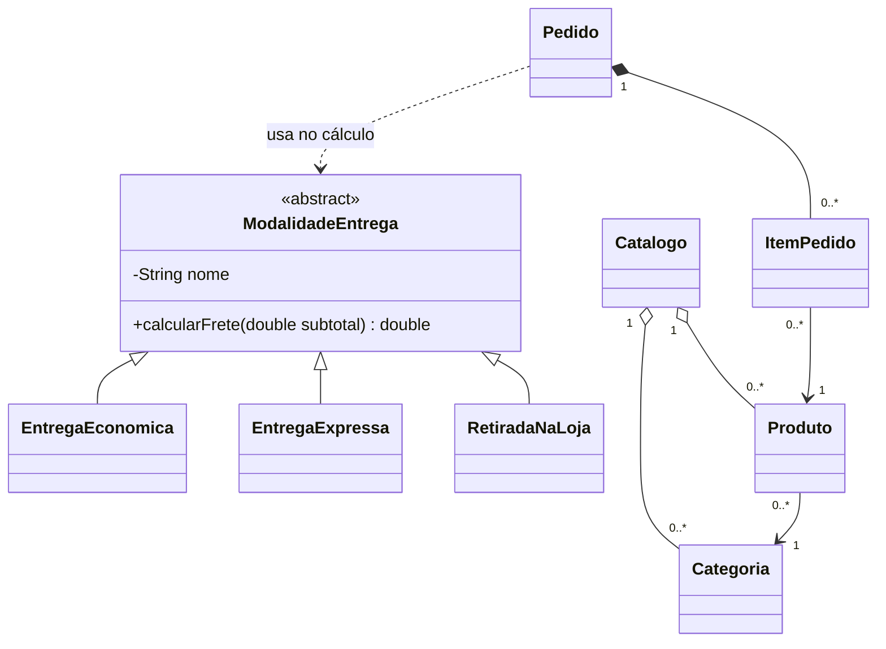

# Atividade Loja Virtual

Uma pequena loja precisa organizar seu catálogo e simular pedidos. O gerente pode cadastrar categorias e produtos. Cada pedido reúne produtos e quantidades, e o cliente pode comparar o valor final usando diferentes modalidades de entrega.

Implemente as partes indicadas no projeto-base. Os dados serão criados no `main`; cadastrar significa inserir objetos nas estruturas em memória. Não é necessário criar uma tela para o gerente.

## Classes e responsabilidades

| Classe | Dados principais | Responsabilidade |
|---|---|---|
| `Categoria` | `codigo`, `nome` | Representar uma categoria cadastrável. |
| `Produto` | `codigo`, `nome`, `preco`, `categoria` | Representar um produto do catálogo. |
| `Catalogo` | Categorias e produtos | Cadastrar, buscar por código e listar produtos de uma categoria. |
| `ItemPedido` | `produto`, `quantidade` | Representar uma linha do pedido e calcular seu subtotal. |
| `Pedido` | Lista de itens | Adicionar produtos, calcular subtotal e calcular total com entrega. |
| `ModalidadeEntrega` | `nome` | Definir a operação abstrata de cálculo de frete. |
| `EntregaEconomica` | Dados herdados | Aplicar tarifa fixa ou gratuidade conforme o subtotal. |
| `EntregaExpressa` | Dados herdados | Aplicar tarifa fixa de entrega expressa. |
| `RetiradaNaLoja` | Dados herdados | Aplicar frete zero. |

## Relações do modelo



O pedido cria seus próprios itens; não recebe um `ItemPedido` pronto. Um produto existe independentemente do pedido e pode ser compartilhado por vários pedidos. A composição representa a propriedade dos itens pelo pedido, não uma instrução de destruição imediata de objetos em Java.

## Regras de negócio

| Regra | Descrição | Classe responsável |
|---|---|---|
| RN01 | Códigos são inteiros positivos. Nomes não podem ser nulos, vazios ou apenas espaços. | `Categoria`, `Produto` — fornecidas |
| RN02 | O preço deve ser positivo e finito. Todo produto possui uma categoria não nula. | `Produto` — fornecida |
| RN03 | O catálogo não aceita código de categoria repetido nem código de produto repetido. Um código de categoria pode coincidir com um código de produto. | `Catalogo` — fornecida |
| RN04 | Um produto só pode ser cadastrado se sua categoria já estiver cadastrada, usando o objeto de categoria registrado no catálogo. | `Catalogo` — fornecida |
| RN05 | O filtro por categoria compara os códigos e devolve uma lista de produtos; sem correspondências, devolve uma lista vazia. | `Catalogo` |
| RN06 | Adicionar um produto exige referência não nula e quantidade maior que zero. A versão sem quantidade adiciona uma unidade. | `Pedido` |
| RN07 | Adicionar novamente o mesmo código de produto aumenta a quantidade da linha existente. Não cria outra linha. | `Pedido`, `ItemPedido` |
| RN08 | O subtotal do item é preço × quantidade. O subtotal do pedido é a soma dos subtotais dos itens. Pedido vazio tem subtotal zero. | `ItemPedido`, `Pedido` |
| RN09 | Entrega econômica custa R$ 10,00 para subtotal menor que R$ 200,00 e é gratuita a partir de R$ 200,00, inclusive. | `EntregaEconomica` |
| RN10 | Entrega expressa custa R$ 20,00, independentemente do subtotal. Retirada na loja é gratuita. | `EntregaExpressa`, `RetiradaNaLoja` |
| RN11 | O total é subtotal + frete. Calcular total exige pedido com pelo menos um item e modalidade não nula. | `Pedido` |
| RN12 | Calcular o total não modifica os itens nem armazena a modalidade. O mesmo pedido pode ser simulado com todas as modalidades. | `Pedido` |

Para simplificar, os produtos permanecem com preço e categoria fixos após a criação e possuem códigos únicos no catálogo. O `main` usa nos pedidos os objetos obtidos desse catálogo. Não há controle de estoque, descontos, impostos, pagamento ou fechamento no núcleo.

Use `double` para acompanhar o exemplo já estudado e apresente valores monetários com duas casas decimais. Nos testes, compare valores com tolerância, por exemplo `0.001`. Essa é uma simplificação didática; a representação monetária pode ser revista em uma etapa posterior.

As operações inválidas devem lançar `IllegalArgumentException`; calcular o total de um pedido vazio deve lançar `IllegalStateException`. O professor fornece os trechos de lançamento e captura para que o foco seja identificar e implementar as condições. Valide antes de modificar a quantidade ou inserir um item: uma tentativa inválida deve preservar o pedido.

## Contratos mínimos a implementar

```java
// Catalogo
public ArrayList<Produto> listarPorCategoria(Categoria categoria);

// ItemPedido
public double calcularSubtotal();
public void aumentarQuantidade(int quantidade);

// Pedido
public void adicionarProduto(Produto produto);
public void adicionarProduto(Produto produto, int quantidade);
public double calcularSubtotal();
public double calcularTotal(ModalidadeEntrega modalidade);
public int contarItens(); // número de linhas, não de unidades

// ModalidadeEntrega
public abstract double calcularFrete(double subtotal);
```

O filtro rejeita categoria nula. A classe abstrata fornece construtor para o nome e `getNome()`. Cada subclasse define seu nome via `super` e implementa `calcularFrete` com `@Override`. O parâmetro do frete será o subtotal não negativo calculado pelo pedido.

As assinaturas de construtores e dos métodos já fornecidos devem acompanhar o projeto-base:

```java
new Categoria(int codigo, String nome);
new Produto(int codigo, String nome, double preco, Categoria categoria);
new Catalogo();
catalogo.cadastrarCategoria(Categoria categoria);
catalogo.cadastrarProduto(Produto produto);
catalogo.buscarProduto(int codigo); // retorna Produto; null se não encontrado
new Pedido();
new EntregaEconomica();
new EntregaExpressa();
new RetiradaNaLoja();
```

`ItemPedido` recebe produto e quantidade no construtor, utilizado por `Pedido`. O projeto-base fornece seus getters. Um item nunca possui quantidade zero ou negativa.

## Exigências de POO

1. `ModalidadeEntrega` deve ser abstrata. Ela não possui um cálculo genérico de frete para ser instanciada diretamente.
2. As três modalidades devem herdar dessa classe e sobrescrever `calcularFrete`.
3. `Pedido.calcularTotal` deve chamar `modalidade.calcularFrete(subtotal)`. Não selecionar a regra de entrega por nome, `instanceof`, `switch` ou conversão de tipos.
4. `adicionarProduto(produto)` deve delegar para `adicionarProduto(produto, 1)`, concentrando a regra na versão com quantidade.
5. Os atributos devem ser privados. A quantidade deve mudar por uma operação que preserve sua validade.

A sobrecarga ocorre entre as duas assinaturas de `adicionarProduto`, escolhidas conforme os argumentos da chamada. A sobrescrita ocorre nas subclasses de entrega; a implementação executada depende do objeto recebido como `ModalidadeEntrega`.

### Exemplo de uso esperado

```java
Categoria perifericos = new Categoria(1, "Periféricos");
Categoria papelaria = new Categoria(2, "Papelaria");
Catalogo catalogo = new Catalogo();
catalogo.cadastrarCategoria(perifericos);
catalogo.cadastrarCategoria(papelaria);

Produto teclado = new Produto(101, "Teclado", 120.0, perifericos);
Produto mouse = new Produto(102, "Mouse", 50.0, perifericos);
Produto caderno = new Produto(103, "Caderno", 30.0, papelaria);
catalogo.cadastrarProduto(teclado);
catalogo.cadastrarProduto(mouse);
catalogo.cadastrarProduto(caderno);

Pedido pedido = new Pedido();
pedido.adicionarProduto(teclado);
pedido.adicionarProduto(mouse);
pedido.adicionarProduto(mouse); // aumenta a quantidade da linha do mouse

ModalidadeEntrega[] modalidades = {
    new EntregaEconomica(),
    new EntregaExpressa(),
    new RetiradaNaLoja()
};

System.out.println("Linhas: " + pedido.contarItens()); // 2
System.out.printf("Subtotal: R$ %.2f%n", pedido.calcularSubtotal()); // 220,00
for (ModalidadeEntrega modalidade : modalidades) {
    System.out.printf("%s: R$ %.2f%n",
        modalidade.getNome(), pedido.calcularTotal(modalidade));
}
```

Resultados: econômica R$ 220,00; expressa R$ 240,00; retirada R$ 220,00. O separador decimal da impressão depende da configuração de localidade do ambiente.

### Cenários de verificação obrigatórios

Cada cenário de pedido começa com um novo pedido, salvo indicação contrária.

| Cenário | Resultado esperado |
|---|---|
| Teclado de R$ 120,00 + duas unidades de mouse de R$ 50,00 | Duas linhas; subtotal R$ 220,00; totais R$ 220,00 / R$ 240,00 / R$ 220,00, na ordem econômica / expressa / retirada. |
| Uma unidade de mouse | Subtotal R$ 50,00; econômica total R$ 60,00. |
| Quatro unidades de mouse | Subtotal R$ 200,00; econômica total R$ 200,00. |
| Subtotal de R$ 199,99, com produto específico para teste | Frete econômico R$ 10,00; total R$ 209,99. |
| Adicionar mouse sem quantidade e depois com quantidade 2 | Uma linha com três unidades; subtotal R$ 150,00. |
| Adicionar quantidade zero ou negativa a um pedido com mouse | Erro; quantidade e subtotal anteriores preservados. |
| Adicionar produto nulo | Erro; pedido preservado. |
| Pedido vazio | Subtotal zero; cálculo do total rejeitado. |
| Pedido não vazio com modalidade nula | Cálculo do total rejeitado. |
| Filtrar Periféricos no catálogo do exemplo | Teclado e mouse; caderno não aparece. |
| Cadastrar categoria “Livros”, sem produtos, e filtrá-la | Lista vazia; nenhuma alteração no código da classe `Categoria`. |

Registre resultado esperado e obtido. Não é obrigatório usar JUnit; verificações no `main` são suficientes. O professor fornece a estrutura para executar todos os cenários sem interromper a aplicação no primeiro erro esperado.

### Entrega dos alunos

- Arquivos `.java` que compilam e executam.
- `Main` demonstrando sobrecarga, repetição de produto e execução polimórfica das três modalidades.
- Registro dos cenários de verificação em um pequeno `README.md`.
- Respostas breves: por que categoria é classe? Onde há composição? Qual a diferença entre sobrecarga e sobrescrita neste programa? O que precisa mudar para acrescentar uma modalidade de entrega?
